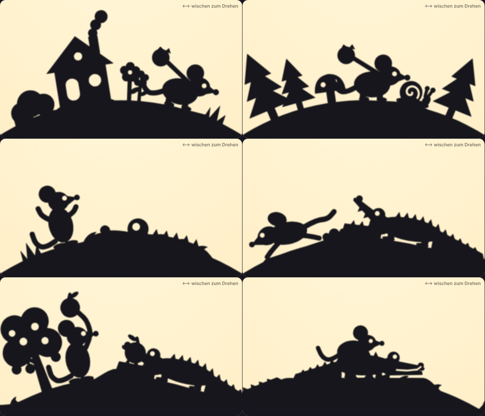

# Schattenrad

Drehscheiben-Kulissen für Taschenlampen-Schattenspiele – entwerfen, prüfen, lasern.

Eine runde Scheibe mit Silhouetten am Rand, ein Bleistift als Achse, eine Taschenlampe dahinter: Beim Drehen ziehen die Szenen über die Wand und man erzählt dazu eine Geschichte.

## Funktionen

- **① Fertige Geschichte „Die Wandermaus“** – sechs von Hand gezeichnete Szenen mit Wand-Vorschau (wischen zum Drehen) und Vorlesetext.
- **② KI-Bild → SVG** – ein rundes Schwarz-Weiß-Bild vektorisieren, die Mitte finden, skalieren, Mittelloch setzen, lose Teile markieren.
- **② Szenen-Bild → Rad** – ein KI-Bild mit 4–8 einzelnen Szenen: Die Szenen werden automatisch erkannt, ausgeschnitten, in Lesereihenfolge sortiert und entlang des Kreisbogens gebogen.
- **③ Baukasten** – Figuren aus der Bibliothek oder eigene KI-Figuren frei auf dem Rand platzieren.
- **Prompts** für Nano Banana & Co. sowie Bau- und Lichttipps.

Export: SVG in Millimetern, rote Haarlinie (0,1 mm) = Schnitt, Standard Ø 200 mm, 8-mm-Loch für einen Bleistift.

## Nutzung

Alles steckt in einer einzigen `index.html` ohne Build-Schritt und ohne Abhängigkeiten. Lokal einfach öffnen oder per GitHub Pages ausliefern:
**Settings → Pages → Deploy from a branch → `main` / root**.

`beispiele/wandermaus-200mm.svg` ist die fertige Schneidedatei der Wandermaus.
